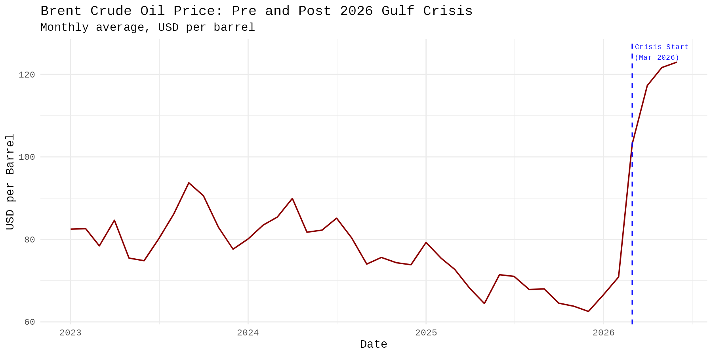
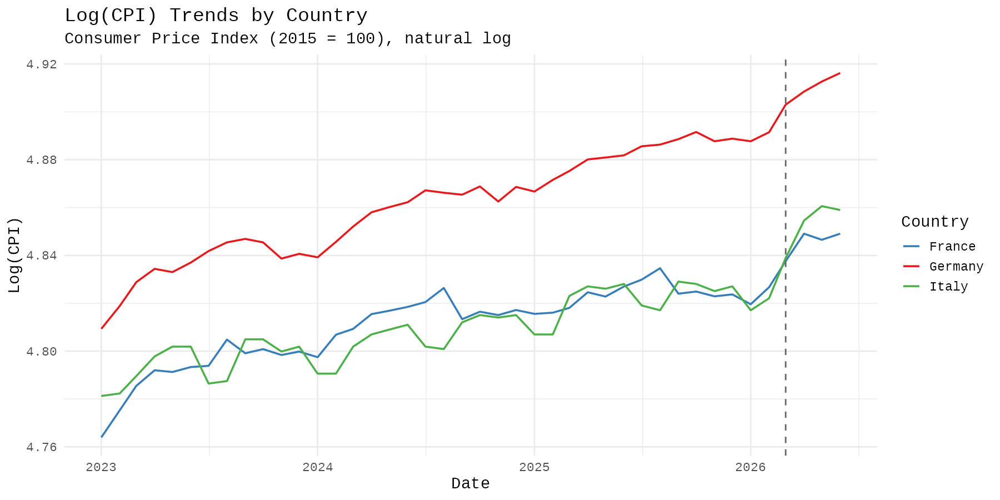
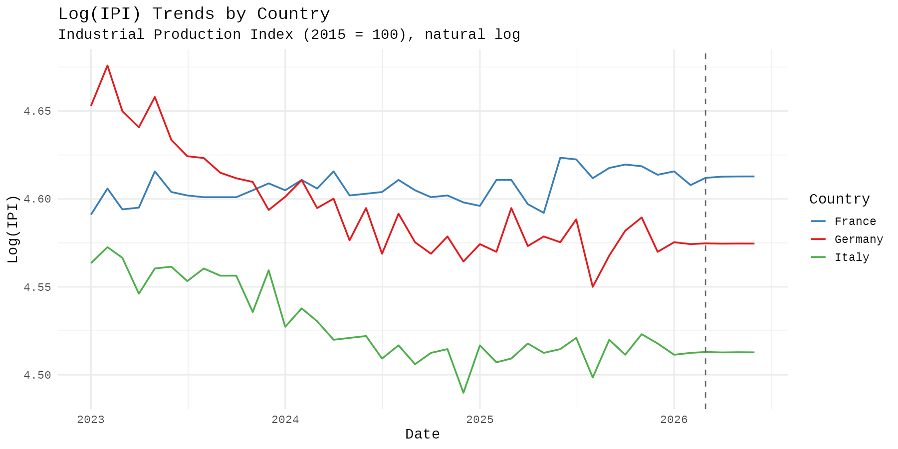
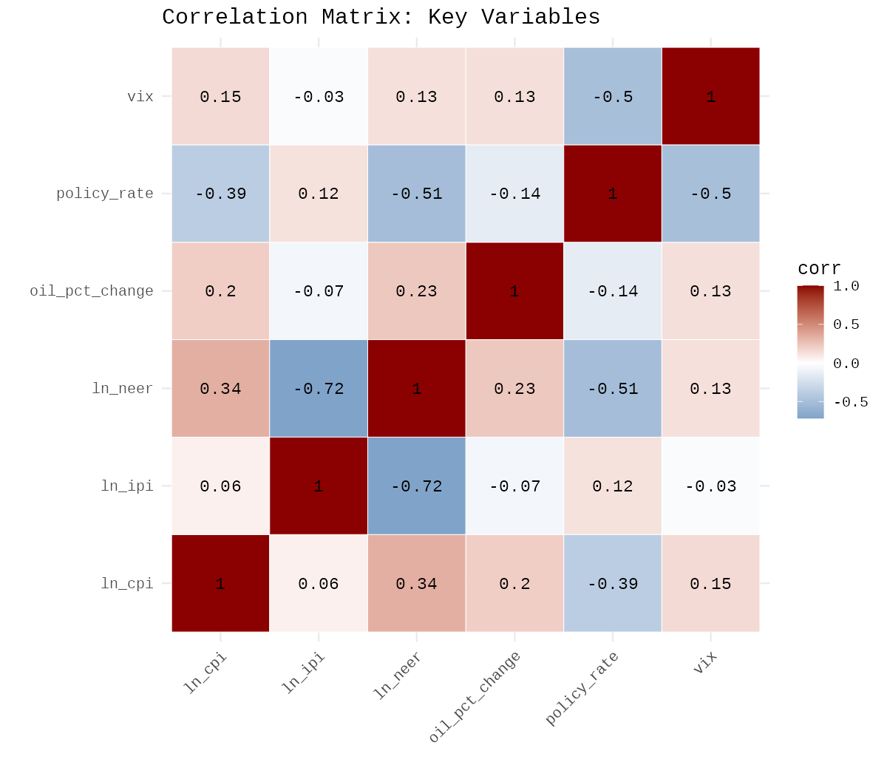

# The Geopolitics of Oil
### Macroeconomic Impact of the 2026 Gulf Crisis on Germany, France and Italy


> Advanced Econometrics (BA 351) | Tunis Business School, University of Tunis | Academic Year 2025-2026

---

## Table of Contents
1. [Overview](#overview)
2. [Authors](#authors)
3. [Dataset](#dataset)
4. [Data Pipeline](#data-pipeline)
5. [Key Findings](#key-findings)
6. [Selected Figures](#selected-figures)
7. [Caveats and Limitations](#caveats-and-limitations)
8. [Repository Structure](#repository-structure)
9. [How to Reproduce](#how-to-reproduce)

---

## Overview

This project measures how the oil price shock triggered by the **2026 Gulf Crisis** affected **consumer price inflation (CPI)** and **industrial production (IPI)** in the three largest Eurozone economies: **Germany, France and Italy**.

It uses monthly panel data from **January 2023 to June 2026** and compares three estimators: **Pooled OLS**, **Fixed Effects (FE)** and **Random Effects (RE)**. Model choice is guided by the Hausman and Breusch-Pagan LM tests, and serial correlation is handled with Arellano (1987) robust standard errors.

| | |
|---|---|
| **Countries** | Germany (DEU), France (FRA), Italy (ITA) |
| **Period** | Jan 2023 - Jun 2026 (42 months) |
| **Observations** | 126 (3 countries x 42 months), perfectly balanced |
| **Dependent variables** | `ln_cpi`, `ln_ipi` |
| **Crisis start** | March 2026 (`post_crisis = 1`) |
| **Forecasted values** | April - June 2026 are ARIMA forecasts, not observed data |

---

## Authors

| Name |
|---|
| Sarah Mneja |
| Hadil Bouattour |
| Hana Bouaziz |
| Sirine Zaltni |
| Maryem Ammar |

**Supervisor:** Professor Naceur Khraief

---

## Dataset

**File:** `panel_data_econometrics.csv` (long panel format, country-month, no missing values)

| Variable | Description | Source |
|:---|:---|:---|
| `country` | DEU, FRA, ITA | n/a |
| `date` | Monthly date (YYYY-MM-DD) | n/a |
| `cpi` / `ln_cpi` | Consumer Price Index (2015 = 100) and its log | OECD (G20 Prices, `CPALTT01`) |
| `ipi` / `ln_ipi` | Industrial Production Index (2015 = 100) and its log | IMF IFS (`PI`) |
| `brent` | Brent crude oil price (USD/barrel) | FRED (`DCOILBRENTEU`) |
| `neer` / `ln_neer` | Nominal Effective Exchange Rate and its log | IMF IFS (`EER`) |
| `policy_rate` | ECB policy rate (%), see [note](#data-notes) | FRED (`ECBMLFR`) |
| `vix` | CBOE Volatility Index | FRED (`VIXCLS`) |
| `oil_pct_change` | Monthly % change in Brent (the oil shock) | Computed |
| `post_crisis` | Dummy: 1 if date >= 2026-03-01 | Computed |

### Data notes
- **Forecast period:** values for April-June 2026 (including Brent, VIX, CPI, IPI and the policy rate) come from ARIMA forecasts. The post-crisis window therefore contains only about one month of fully observed data.
- **Policy rate series:** on FRED, `ECBMLFR` is the ECB Marginal Lending Facility rate, whereas the report describes it as the main refinancing rate. Check which one you intend to use and label it consistently.

---

## Data Pipeline

```
Raw CSVs (6 files)
      |
      v
1. Load & merge on (country, date) via sequential left joins
      |
      v
2. Clean: linear interpolation + LOCF  ->  zero missing values
      |
      v
3. Transform: ln_cpi, ln_ipi, ln_neer
      |
      v
4. Shock variable: oil_pct_change = (Brent_t - Brent_t-1) / Brent_t-1 x 100
      |
      v
5. Crisis dummy: post_crisis = 1 from March 2026
      |
      v
6. ARIMA forecast of Apr-Jun 2026 values for all variables
      |
      v
panel_data_econometrics.csv
```

---

## Key Findings

*The full analysis is in `Geopolitics_of_Oil_2026_Gulf_Crisis_Report.pdf`.*

### Inflation model (`ln_cpi`)

| Item | Result |
|:---|:---|
| Oil shock | Not significant in any specification (p > 0.10) |
| Post-crisis dummy | Significant in FE and RE: structural level shift of about **+2.3 percentage points** (p < 0.001) |
| Dominant driver | `ln_neer`: **beta = 0.790\*\*\*** in RE (0.797\*\*\* in FE). A 1% currency appreciation is associated with about 0.79% higher CPI |
| Model selection | Hausman test fails to reject H0 (chi2 = 0.440, p = 0.994), so **Random Effects** is preferred |

### Growth model (`ln_ipi`)

| Item | Result |
|:---|:---|
| Oil shock | Not significant (correct negative sign in FE) |
| Dominant driver | `ln_neer`: **beta = -0.701** in FE. Significant at the 0.1% level with conventional standard errors, but only at the 5% level (p = 0.042) with Arellano robust standard errors |
| Model selection | Hausman test (chi2 = 32.49, p < 0.001) favors **Fixed Effects** |

### Country heterogeneity (oil shock coefficient, country-level OLS, T = 42)

| Country | beta (CPI) | p-value | beta (IPI) | p-value |
|:---|---:|---:|---:|---:|
| Germany | +0.000063 | 0.697 | -0.000048 | 0.894 |
| France | -0.000187 | 0.293 | +0.000006 | 0.964 |
| Italy | -0.000229 | 0.095 | +0.000062 | 0.832 |

No country shows a significant oil shock effect at the 5% level. Italy comes closest (p = 0.095), but its CPI coefficient is negative, the opposite of the cost-push prediction. France's nuclear-heavy electricity mix is cited as a possible hedge.

### Takeaway
Oil price changes are statistically insignificant for both inflation and industrial output in this sample, while the exchange rate is the main transmission channel. The crisis period itself is associated with a significant structural rise in CPI.

---

## Selected Figures

All figures are generated by `analysis.r` and saved in [`output/`](output/).

### Brent crude oil price


### Log CPI by country


### Log industrial production by country


### Correlation heatmap


---

## Caveats and Limitations

- **Small cross-section (N = 3):** low statistical power, and cluster-robust (Arellano) standard errors are unreliable with only three clusters. Treat the very large robust t-statistics (for example for VIX in the CPI model) with caution.
- **Forecast-based window:** the post-crisis dummy relies mostly on ARIMA-forecast values for April-June 2026. Results should be revised as official data become available.
- **Short post-crisis horizon:** energy shocks typically affect output with a 3-6 month lag, so the full effect on IPI may not yet be visible.
- **Possible endogeneity:** the policy rate may respond to inflation, and VIX may co-move with inflation expectations. Instrumental variable estimation is suggested for future work.
- **Time fixed effects:** the oil shock is common across countries, so it is collinear with time effects in a two-way specification. A one-way (country) FE specification is used to identify its coefficient.
- **Linear specification:** positive and negative oil shocks are assumed to have symmetric effects. Asymmetric or NARDL models are a possible extension.
- **Diagnostics:** the report covers the Hausman, Breusch-Pagan LM and Durbin-Watson tests. A dedicated heteroskedasticity test (for example Breusch-Pagan on the regression residuals) could be added.

---

## Repository Structure

```text
Advanced Econometrics Project Geopolitics Of Oil/
|
|-- R/
|   |-- analysis.r                    # Pooled OLS, FE, RE, Hausman and diagnostic tests
|   `-- merge and arima forecast.r    # Merging, cleaning and ARIMA forecasting
|
|-- variables/                        # Raw data
|   |-- DCOILBRENTEU.csv              # Brent oil prices (FRED)
|   |-- VIXCLS.csv                    # VIX index (FRED)
|   |-- ECBMLFR.csv                   # ECB policy rate (FRED)
|   |-- neer.csv                      # Nominal effective exchange rates (IMF IFS)
|   |-- ipi.csv                       # Industrial production index (IMF IFS)
|   |-- OECD_CPI_DE_FR_IT.csv         # CPI (OECD)
|   `-- links.txt                     # Data source documentation
|
|-- output/                           # Results generated by analysis.r
|   |-- 01_brent_oil_price.png
|   |-- 02_ln_cpi_by_country.png
|   |-- 03_ln_ipi_by_country.png
|   |-- 04_oil_price_shock.png
|   |-- 05_vix_index.png
|   |-- 06_combined_faceted.png
|   |-- 07_correlation_heatmap.png
|   |-- 08_means_by_country.csv
|   |-- 09_descriptive_stats_by_country.csv
|   |-- 10_correlation_matrix.csv
|   |-- 11_pre_post_crisis_comparison.csv
|   |-- 12-17_*.txt                   # Pooled OLS, FE and RE summaries (inflation and growth)
|   |-- 18-19_fe_interaction_*.txt    # FE with oil shock x post-crisis interaction
|   |-- 20-21_twoway_fe_*.txt         # Two-way fixed effects
|   |-- 22-23_importers_fe_*.txt      # Importers FE models
|   |-- 24-29_table*.txt              # Regression tables (inflation, growth, all models, advanced, by country)
|   |-- 30_diagnostic_tests.txt       # Hausman, Breusch-Pagan LM and serial correlation tests
|   |-- 31_key_findings_summary.txt
|   |-- 32_table_inflation_latex.tex
|   `-- 33_table_growth_latex.tex
|
|-- panel_data_econometrics.csv       # Final cleaned panel (N = 126)
|-- Geopolitics_of_Oil_2026_Gulf_Crisis_Report.pdf   # Final research paper
|-- README.md
`-- .gitignore
```

---

## How to Reproduce

The scripts were developed and run in **Google Colab** with an R runtime, so that is the recommended way to reproduce the results.

### Option A: Google Colab (recommended)
1. Go to [colab.research.google.com](https://colab.research.google.com), create a new notebook and set **Runtime > Change runtime type > R**.
2. Upload the six raw CSV files from `variables/` to the Colab file panel (left sidebar). They land in `/content/`, which is the working directory the merge script reads from. The script expects the CPI file to be named `OECD_CPI_DE_FR_IT.csv.csv` (double extension), so either rename the uploaded file or change the filename in the script.
3. Run `merge and arima forecast.r`. It installs `tidyverse`, `lubridate`, `zoo` and `forecast`, merges the raw files, fills gaps by interpolation and LOCF, forecasts April-June 2026 with ARIMA, and writes `panel_data_econometrics.csv` and `.rds` to `/content/`. It also creates `forecasts/forecast_report.csv` and summary plots in `figures/`.
4. Run `analysis.r` (written as numbered Colab cells). It installs `tidyverse`, `plm`, `lmtest`, `stargazer`, `car` and `sandwich` (about 2-3 minutes on the first run) and reads `/content/panel_data_econometrics.csv`. Upload the CSV through the sidebar if it is not already there.
5. Download the outputs before the session ends, since Colab storage is temporary.

### Option B: RStudio (local)
- Set the working directory to the folder containing the raw CSVs with `setwd()` before running `merge and arima forecast.r`. It uses relative paths, so it needs no other changes.
- In `analysis.r`, change `data_file <- "/content/panel_data_econometrics.csv"` (and the matching check in Cell 0) to a local path such as `"panel_data_econometrics.csv"`.
- Make sure all the packages listed above are installed.
